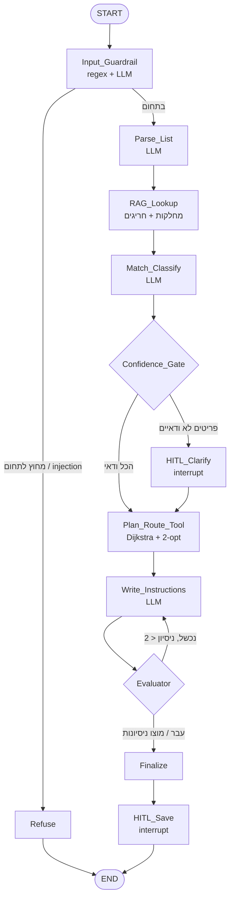

# Grocery Route Agent · אייג'נט מסלול קניות

אייג'נט ממוקד משימה: מקבל רשימת קניות בטקסט חופשי (או רשימה שבועית שהצטברה), משייך כל פריט למחלקה שלו בחנות מסוימת,
ומחזיר **את סדר ההליכה הקצר ביותר** בחנות כדי לאסוף את הכל ולצאת לקופות.

החנות לא צריכה לתחזק קטלוג מוצרים: מספיקים מפה, רשימת מחלקות עם כמה דוגמאות לכל אחת,
ורשימה קצרה (לא חובה) של מוצרים חריגים - כאלה שלא נמצאים במחלקה הצפויה (למשל סוללות ליד הקופות).

```
> 2 חלב, לחם אחיד, טחינה, עגבניות, גלידה, סוללות

[INFO] Entering Node: Input_Guardrail
[INFO] Entering Node: Parse_List
[INFO] Entering Node: RAG_Lookup
[INFO] Entering Node: Match_Classify
[GATE] 6 פריטים ודאיים, 0 דורשים הבהרה
[TOOL] מסלול: 86.1 מ' (לעומת 144.6 מ' לפי סדר הרשימה, חיסכון 58 מ')
[EVAL] ההוראות תואמות למסלול

1. ירקות ופירות - עגבניות
2. מאפייה - לחם אחיד
3. חלב וביצים - חלב x2
4. מעבר 5 - טחינה
5. קפואים - גלידה (בסוף המסלול, כדי שלא יימס)
6. קופות - סוללות
```

## ארכיטקטורה



### עקרון התכנון: מה עושה ה-LLM ומה עושה הקוד

| שלב | מי מבצע | למה |
|---|---|---|
| זיהוי תחום, נרמול רשימה, שיוך למחלקה, ניסוח | **LLM** | הבנת טקסט חופשי ושגיאות כתיב, וידע כללי על איפה נמכר כל מוצר - כך שלא צריך לרשום כל מוצר בחנות |
| שליפת מחלקות ומוצרים חריגים | **RAG** | מוצר חריג גובר על המחלקה ה"הגיונית"; הצעות ה-RAG משמשות גם כאפשרויות כשה-LLM לא בטוח |
| חישוב מסלול | **קוד (כלי פנימי)** | בעיה אלגוריתמית (וריאציה של TSP). מודל שפה פותר אותה פחות טוב, פחות יציב ויקר יותר |
| בדיקת הפלט | **Evaluator דטרמיניסטי** | בודק שכל מוצר מופיע ושסדר העצירות זהה למסלול שחושב. אמין יותר משופט LLM, ובלי עלות |

### רכיבי בקרה

| רכיב | מימוש |
|---|---|
| **GuardRails** | `Input_Guardrail`: חסימת prompt-injection ב-regex (בלי קריאה למודל), ואז סיווג תחום ב-LLM. בנוסף, ב-`Match_Classify` כל `product_id` ושם מחלקה שה-LLM מחזיר נבדקים מול מה שקיים בחנות (מניעת הזיות) |
| **Gates** | `Confidence_Gate`: פריט עם `confidence < 0.7`, או עם כמה מוצרים אפשריים, עובר להבהרה - **רק אם האפשרויות נמצאות במקומות שונים בחנות**. אם כולן באותו אזור (חלב 3% / 1% באותו מקרר), הבחירה לא משנה את המסלול ולא שואלים |
| **HITL** | `interrupt()` של LangGraph בשני מקומות: הבהרת פריטים, ואישור `[Y/N]` לפני כתיבת קובץ. גם `clear` ו-`summary` ב-CLI מבקשים אישור |
| **Evaluator** | לולאת תיקון: אם הניסוח נכשל בבדיקה, חוזרים ל-`Write_Instructions` עם המשוב. אחרי 2 כישלונות - תבנית גיבוי דטרמיניסטית |
| **RAG** | שני אינדקסים: מחלקות (שם + דוגמאות) ומוצרים חריגים (שם + כינויים). TF-IDF על n-grams של תווים (2-3). עמיד לשגיאות כתיב ותחיליות בעברית, רץ מקומית בלי API של embeddings (חשוב גם ל-exe) |
| **Route Tool** | כלי Python פנימי (לא הרצת קוד שרירותי, ולכן `code_execution: false` ב-manifest). `StoreMap.plan`: Dijkstra בין כל צמתי המפה, nearest-neighbor ו-2-opt לסדר העצירות. אילוץ: אזור עם מוצר שנמס (גלידה - ה-LLM מזהה, או סימון "לאסוף בסוף" בחריגים) אחרון לפני הקופות. המפה נבנית מציור בתאי אקסל (כל תא = משבצת בגרף) |
| **LangSmith** | מוגדר דרך משתני סביבה; כל ריצה מתויגת בשם המודל. [trace לדוגמה](https://smith.langchain.com/public/0baa9271-6b0e-499e-87f0-dfbb767be8b4/r/01a17865-3215-71a3-81ae-14b225496bf5) - עץ הנודים של הגרף, קריאות ה-LLM, טוקנים וזמן לכל שלב |
| **Streaming** | כל נוד מדפיס `[INFO] Entering Node: ...` עם התקדמות ([GATE], [TOOL], [EVAL]) |
| **עלויות** | `CostTracker` רושם טוקנים ועלות לכל נוד; טבלה מוצגת בסוף כל משימה. תמחור חי מ-OpenRouter API, עם קובץ גיבוי |

## מבנה הפרויקט

```
grocery-route-agent/
├── agent/
│   ├── graph.py          # הגדרת ה-LangGraph workflow + הרצה עם HITL
│   ├── nodes.py          # נודים: guardrail, parse, match, gate, HITL, evaluator...
│   ├── tools.py          # RAG על המחלקות והחריגים, חישוב מסלול, קבצים
│   ├── llm.py            # חיבור ל-OpenRouter, פענוח JSON, מעקב עלויות
│   ├── pricing.py        # תמחור מודלים (חי + גיבוי)
│   ├── mock.py           # LLM מדומה למצב הדגמה ובדיקות
│   ├── config.py
│   ├── cli.py            # entrypoint של ה-CLI
│   ├── server.py         # שרת FastAPI לממשק ה-Web (SSE + HITL בדפדפן)
│   └── data/stores/
│       ├── demo_store/store.xlsx               # חנות הדמו: ציור בתאים + מחלקות + חריגים
│       └── demo_store_json/{map.json, catalog.csv}   # אותה חנות בפורמט הישן (גרף)
├── evals/
│   ├── compare_models.py # eval השוואת מודלים
│   ├── cost_eval.py      # eval עלויות
│   ├── scope_eval.py     # eval מקצועיות ואי-זליגה
│   ├── rubric.md         # rubric ל-LLM-as-judge
│   ├── data/             # רשימות בדיקה עם ground truth, שאלות מחוץ לתחום
│   └── results/          # פלטי CSV
├── web/                  # ממשק Web/Desktop: React + Vite (נבנה ל-web/dist)
├── tests/                # test_agent.py, test_server.py
├── manifest.json
├── requirements.txt
├── build_exe.bat
├── run_agent.py          # entrypoint ל-PyInstaller (CLI)
├── run_web.py            # entrypoint לממשק ה-Web (agent-web.exe)
├── build_web_exe.bat
├── check_store.py        # בדיקת קובץ חנות חדש
├── store_template.xlsx   # תבנית ריקה לחנות חדשה
└── .env.example
```

## התקנה והרצה

```bash
pip install -r requirements.txt
cp .env.example .env        # ומלאו OPENROUTER_API_KEY ו-LANGSMITH_API_KEY
python -m agent.cli
```

בלי מפתח (הדגמה בלבד, ללא מודל אמיתי): `AGENT_MOCK=1 python -m agent.cli`

### פקודות CLI

| פקודה | פעולה |
|---|---|
| `<טקסט חופשי>` | חישוב מסלול לרשימה שנכתבה |
| `add <פריטים>` / `list` / `remove <n>` / `clear` | ניהול הרשימה השבועית (נשמרת בין הפעלות) |
| `plan` | מסלול לכל הרשימה השבועית |
| `load <נתיב>` | מסלול לרשימה מקובץ טקסט מקומי |
| `store [שם]` / `model [מזהה]` | החלפת חנות / מודל |
| `tools` | הרחבות פעילות |
| `cost` | עלות מצטברת בהפעלה |
| `summary` | ייצוא תקציר שיחה לקובץ (בונוס) |
| `help` / `?` | מדריך שימוש |

### הוספת חנות
החנות ממלאת קובץ אקסל אחד לפי [store_template.xlsx](store_template.xlsx), עם שלוש לשוניות:

- **מפת החנות**: ציור במבט מלמעלה, כל תא בערך מטר על מטר. תא ריק = מקום הליכה, `X` = מדף או קיר,
  טקסט = אזור (המקום שבו הלקוח עומד כשהוא לוקח מוצרים, למשל `מעבר 3`). חובה תא `כניסה` ותא `קופות`.
  אפשר למזג תאים. שורה 1 להגדרות (שם החנות, מטר למשבצת), והציור מתחיל בשורה 3.
- **מחלקות** (חובה): `מחלקה, אזור, מה נמכר כאן`. `אזור` הוא הטקסט שבציור (כמה מחלקות יכולות לחלוק אזור),
  ו`מה נמכר כאן` = כמה דוגמאות מופרדות בפסיקים. לא צריך רשימה מלאה - ה-LLM משייך כל מוצר לפי הדוגמאות וידע כללי.
- **חריגים** (לא חובה): `מק"ט, שם המוצר, שמות נוספים, קטגוריה, אזור, לאסוף בסוף`, רק למוצרים שלא נמצאים
  במחלקה הצפויה (סוללות ליד הקופות, חלב סויה במעבר הקפה). `לאסוף בסוף` = `כן` למוצר שנמס.

בודקים את הקובץ עם `python check_store.py <קובץ>`, שמסביר בעברית מה לתקן (אזור שלא קיים בציור,
אזור חסום, חסרה כניסה וכו'), ואז שומרים אותו בשם `agent/data/stores/<שם>/store.xlsx`.

פורמטים קודמים עדיין נתמכים, ובהם המחלקות נגזרות מהקטגוריות של הקטלוג וכל המוצרים נחשבים "ידועים":
קובץ אקסל עם לשונית `מוצרים` (קטלוג מלא), או `map.json` (צמתים עם קואורדינטות וקשתות) ו-`catalog.csv`
(`id,name,aliases,category,location,collect_last`), כמו ב-`demo_store_json`.

## Evals

```bash
python evals/compare_models.py     # זמן, recall/precision מול ground truth, ציון שופט 1-5
python evals/cost_eval.py          # עלות לכל נוד ולכל משימה, בפועל ותיאורטית
python evals/scope_eval.py         # refusal rate על 10 שאלות מחוץ לתחום + 3 שאלות ביקורת
```
- את המודלים קובעים ב-`--models "a,b,c"` או ב-`EVAL_MODELS`. יש לכלול לפחות מודל אחד בתשלום.
- השופט (`JUDGE_MODEL`) קבוע לכל ההשוואות. ה-rubric ב-`evals/rubric.md`.
- `--mock` מריץ את כל ה-evals בלי רשת (לבדיקת התשתית בלבד).
- ב-eval השוואת המודלים, איכות הנתונים נמדדת **גם אובייקטיבית**: לכל פריט ברשימת בדיקה יש אזור צפוי בחנות, ומחושבים recall ו-precision.

### תוצאות (גרסת מחלקות + חריגים, ריצה מ-28.10.2026, הקבצים המלאים ב-`evals/results/`)

> **המודלים החינמיים חסרים:** `nvidia/nemotron-3-ultra-550b-a55b:free` ו-`google/gemma-4-31b-it:free` נחסמו בכל הריצות
> במגבלת הקצב של OpenRouter למודלים חינמיים (שגיאה 429), ולכן אין להם תוצאות לגרסה הזו. מריצים אותם בנפרד
> עם `--models "<מודל>" --append` כשהמגבלה מתאפסת.
> תוצאות הגרסה הקודמת (קטלוג מוצרים מלא, כולל nemotron) שמורות ב-`evals/results/*_catalog_v1.csv`.

**השוואת מודלים** (6 רשימות בדיקה, 33 פריטים, שופט: `openai/gpt-4o-mini`)

| מודל | זמן ממוצע | recall / precision (אזור נכון לכל פריט) | ציון שופט ממוצע (1-5) | עלות ממוצעת למשימה |
|---|---|---|---|---|
| `openai/gpt-4o-mini` | 10.7 שנ' | 1.0 / 1.0 | **4.38** | $0.00072 |
| `google/gemini-2.5-flash-lite` | **4.2 שנ'** | 1.0 / 1.0 | 4.17 | **$0.00057** |

- שני המודלים שייכו כל פריט לאזור הנכון, כולל מוצרים חריגים (סוללות בקופות, חלב סויה במעבר הקפה) ופריטים
  שלא מופיעים באף דוגמה של מחלקה (אבוקדו, קרם הגנה). בכל הריצות ה-Evaluator אישר את ההוראות בניסיון הראשון.
- בהרצה הראשונה gpt-4o-mini קיבל recall של 0.82: הוא "תפס" מוצרים חריגים לפי מילה משותפת או דמיון באותיות
  ("מיץ תפוזים" ← מסטיק, "חלב 3%" ← חלב סויה), גם בניגוד להוראה מפורשת בפרומפט. התיקון בקוד: מוצר חריג נשלח
  ל-LLM רק בהתאמה חזקה לשם או לכינוי (ציון RAG ≥ 0.75), ואז ה-recall עלה ל-1.0.

**עלויות** (לפי נוד ולפי משימה)

| משימה | gpt-4o-mini | gemini-2.5-flash-lite |
|---|---|---|
| רשימה קצרה | $0.00048 | $0.00037 |
| רשימה שבועית ארוכה | $0.00100 | $0.00081 |
| רשימה עם פריטים עמומים | $0.00054 | $0.00042 |
| שאלה מחוץ לתחום (נעצרת ב-Guardrail) | $0.00004 | $0.00004 |

- שאלה מחוץ לתחום עולה כעשירית ממשימה רגילה, כי הגרף נעצר כבר בנוד הראשון.
- לעומת גרסת הקטלוג המלא, משימה עולה עד כ-37% יותר ברשימות קצרות, וכמעט אותו דבר ברשימה השבועית הארוכה: `Match_Classify` מקבל
  את כל המחלקות עם הדוגמאות בכל קריאה (כ-1,600 טוקני קלט ברשימה קצרה). זה המחיר של חנות בלי קטלוג מוצרים.

**מקצועיות ואי-זליגה**

| מודל | refusal rate (10 שאלות מחוץ לתחום) | סירובים שגויים (3 שאלות בתחום) |
|---|---|---|
| `openai/gpt-4o-mini` | 100% | 0% |
| `google/gemini-2.5-flash-lite` | 100% | 0% |

- ריצה שנכשלה (למשל 429) לא נספרת בחישוב, ומספר הריצות שנכשלו מדווח בנפרד.

## ממשק Web / Desktop (מסלול B)

אותו גרף ואותם נודים כמו ב-CLI, עם ממשק גרפי בעברית. שרת FastAPI מקומי עוטף את `run_agent`, וממשק React מתחבר אליו.
החלון נפתח כאפליקציה נפרדת (Edge במצב `--app`), או בלשונית דפדפן רגילה עם `--browser`.

```bash
pip install -r requirements.txt
cd web && npm install && npm run build && cd ..
python run_web.py               # או: agent-web.exe
```

| דרישה | בממשק |
|---|---|
| Streaming | השלבים בגרף מוצגים בזמן אמת (Server-Sent Events), כולל הודעות GATE / TOOL / EVAL |
| HITL | שאלות הבהרה עם בחירת אפשרות, ואישור לפני שמירת המסלול לקובץ. הגרף עוצר ב-`interrupt` עד לתשובה מהדפדפן |
| קבצים | גרירת קובץ txt / csv / md לחלון, או כפתור 📎 |
| עזרה | כפתור `?` בסרגל העליון |
| עלויות | עלות בפועל ותיאורטית, טוקנים, ופירוט לפי נוד בכל משימה. סיכום מצטבר בסרגל העליון |
| שגיאות | הודעה ברורה בכרטיס המשימה (מפתח חסר, 429, מודל לא קיים וכו') |
| תקציר שיחה | כפתור "תקציר שיחה" מוריד קובץ טקסט |
| הרחבות | רשימת ההרחבות הפעילות בצד (MCP לא בשימוש) |

בנוסף: **מפת החנות עם המסלול** מצוירת מתוך קובץ האקסל של החנות, ויש ניהול של הרשימה השבועית מהצד.

**פיתוח:** `python run_web.py` בחלון אחד, ו-`cd web && npm run dev` בחלון שני (Vite מעביר את `/api` לשרת).

**בניית exe:** `build_web_exe.bat` יוצר את `distgent-web.exe`, שכולל את הממשק הבנוי. יש להניח `.env` ליד הקובץ, כמו ב-CLI.

## בדיקות
```bash
pytest -q
```

## בניית agent.exe
ב-Windows, מתוך שורש הפרויקט: `build_exe.bat`. הקובץ נוצר ב-`dist\agent.exe`.
יש להניח קובץ `.env` ליד ה-exe. את הקובץ מעלים לעמוד ה-Releases בגיטהאב (למשל תחת תגית `v1.1.0`).

**עברית בטרמינל של Windows:** הטרמינל לא מציג עברית מימין לשמאל, ולכן ב-Windows הפלט מסודר אוטומטית עם `python-bidi`.
אפשר לכבות עם `AGENT_BIDI=0`.

## מגבלות ידועות
- המפה והמחלקות בדויות (חנות הדגמה).
- השיוך למחלקה נשען על ידע כללי של ה-LLM. מוצר שממוקם בחנות במקום לא צפוי ולא הוגדר בחריגים יישלח למחלקה ה"הגיונית". המפה מניחה מעברים חד-כיווניים פשוטים ולא מתחשבת בעומס.
- המסלול אופטימלי-בקירוב (nearest-neighbor + 2-opt). לרשימות בגודל רגיל זה קרוב מאוד לאופטימום.
- מחירי `pricing_fallback.json` הם הערכה בלבד; בזמן ריצה עם רשת נשלף תמחור עדכני מ-OpenRouter.
