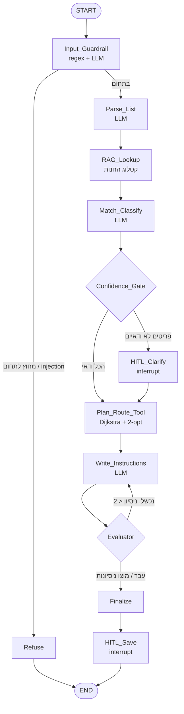

# Grocery Route Agent · אייג'נט מסלול קניות

אייג'נט ממוקד משימה: מקבל רשימת קניות בטקסט חופשי (או רשימה שבועית שהצטברה), מאתר כל מוצר בקטלוג של חנות מסוימת,
ומחזיר **את סדר ההליכה הקצר ביותר** בחנות כדי לאסוף את הכל ולצאת לקופות.

```
> 2 חלב, לחם אחיד, טחינה, עגבניות, גלידה, מטאטא

[INFO] Entering Node: Input_Guardrail
[INFO] Entering Node: Parse_List
[INFO] Entering Node: RAG_Lookup
[INFO] Entering Node: Match_Classify
[GATE] 4 פריטים ודאיים, 2 דורשים הבהרה
[HITL] למה התכוונתם ב-'חלב'?   1. חלב 3%   2. חלב 1%
[HITL] 'מטאטא' לא נמצא בקטלוג. ייתכן שהוא במחלקת ניקיון (מעבר 7). להוסיף עצירה? [Y/N]
[TOOL] מסלול: 126 מ' (לעומת 200 מ' לפי סדר הרשימה)
[EVAL] ההוראות תואמות למסלול

1. ירקות ופירות (קיר שמאלי) - עגבניות
2. מאפייה ולחמים (קיר אחורי) - לחם אחיד פרוס
3. מוצרי חלב וביצים (קיר אחורי) - חלב 3% x2
...
```

## ארכיטקטורה



### עקרון התכנון: מה עושה ה-LLM ומה עושה הקוד

| שלב | מי מבצע | למה |
|---|---|---|
| זיהוי תחום, נרמול רשימה, התאמה וסיווג, ניסוח | **LLM** | הבנת טקסט חופשי, שגיאות כתיב, עמימות ("חלב" = 3% או 1%?), סיווג מוצר לא מוכר למחלקה |
| שליפת מועמדים מהקטלוג | **RAG** | הקטלוג גדול; ה-LLM מקבל רק 3-4 מועמדים לכל פריט ולא יכול להמציא מוצר |
| חישוב מסלול | **קוד (Code-Exec)** | בעיה אלגוריתמית (וריאציה של TSP). מודל שפה פותר אותה פחות טוב, פחות יציב ויקר יותר |
| בדיקת הפלט | **Evaluator דטרמיניסטי** | בודק שכל מוצר מופיע ושסדר העצירות זהה למסלול שחושב. אמין יותר משופט LLM, ובלי עלות |

### רכיבי בקרה

| רכיב | מימוש |
|---|---|
| **GuardRails** | `Input_Guardrail`: חסימת prompt-injection ב-regex (בלי קריאה למודל), ואז סיווג תחום ב-LLM. בנוסף, ב-`Match_Classify` כל `product_id` שה-LLM מחזיר נבדק מול רשימת המועמדים (מניעת הזיות) |
| **Gates** | `Confidence_Gate`: פריט עם `confidence < 0.7` או סטטוס `ambiguous` עובר להבהרה |
| **HITL** | `interrupt()` של LangGraph בשני מקומות: הבהרת פריטים, ואישור `[Y/N]` לפני כתיבת קובץ. גם `clear` ו-`summary` ב-CLI מבקשים אישור |
| **Evaluator** | לולאת תיקון: אם הניסוח נכשל בבדיקה, חוזרים ל-`Write_Instructions` עם המשוב. אחרי 2 כישלונות - תבנית גיבוי דטרמיניסטית |
| **RAG** | אינדקס TF-IDF על n-grams של תווים (2-3), על שם המוצר וכינוייו. עמיד לשגיאות כתיב ותחיליות בעברית, רץ מקומית בלי API של embeddings (חשוב גם ל-exe) |
| **Code-Exec** | `StoreMap.plan`: Dijkstra בין כל צמתי המפה, nearest-neighbor ו-2-opt לסדר העצירות. אילוץ: אזור עם מוצר שמסומן "לאסוף בסוף" (גלידה) אחרון לפני הקופות. המפה נבנית מציור בתאי אקסל (כל תא = משבצת בגרף) |
| **LangSmith** | מוגדר דרך משתני סביבה; כל ריצה מתויגת בשם המודל |
| **Streaming** | כל נוד מדפיס `[INFO] Entering Node: ...` עם התקדמות ([GATE], [TOOL], [EVAL]) |
| **עלויות** | `CostTracker` רושם טוקנים ועלות לכל נוד; טבלה מוצגת בסוף כל משימה. תמחור חי מ-OpenRouter API, עם קובץ גיבוי |

## מבנה הפרויקט

```
grocery-route-agent/
├── agent/
│   ├── graph.py          # הגדרת ה-LangGraph workflow + הרצה עם HITL
│   ├── nodes.py          # נודים: guardrail, parse, match, gate, HITL, evaluator...
│   ├── tools.py          # RAG על הקטלוג, חישוב מסלול, קבצים
│   ├── llm.py            # חיבור ל-OpenRouter, פענוח JSON, מעקב עלויות
│   ├── pricing.py        # תמחור מודלים (חי + גיבוי)
│   ├── mock.py           # LLM מדומה למצב הדגמה ובדיקות
│   ├── config.py
│   ├── cli.py            # entrypoint של ה-CLI
│   └── data/stores/
│       ├── demo_store/store.xlsx               # חנות הדמו: ציור בתאים + מוצרים
│       └── demo_store_json/{map.json, catalog.csv}   # אותה חנות בפורמט הישן (גרף)
├── evals/
│   ├── compare_models.py # eval השוואת מודלים
│   ├── cost_eval.py      # eval עלויות
│   ├── scope_eval.py     # eval מקצועיות ואי-זליגה
│   ├── rubric.md         # rubric ל-LLM-as-judge
│   ├── data/             # רשימות בדיקה עם ground truth, שאלות מחוץ לתחום
│   └── results/          # פלטי CSV
├── tests/test_agent.py
├── manifest.json
├── requirements.txt
├── build_exe.bat
├── run_agent.py          # entrypoint ל-PyInstaller
├── check_store.py        # בדיקת קובץ חנות חדש
├── store_template.xlsx   # תבנית ריקה לחנות חדשה
└── .env.example
```

## התקנה והרצה

```bash
pip install -r requirements.txt
cp .env.example .env        # ומלאו OPENROUTER_API_KEY ו-LANGSMITH_API_KEY
python -m agent.cli
```

בלי מפתח (הדגמה בלבד, ללא מודל אמיתי): `AGENT_MOCK=1 python -m agent.cli`

### פקודות CLI

| פקודה | פעולה |
|---|---|
| `<טקסט חופשי>` | חישוב מסלול לרשימה שנכתבה |
| `add <פריטים>` / `list` / `remove <n>` / `clear` | ניהול הרשימה השבועית (נשמרת בין הפעלות) |
| `plan` | מסלול לכל הרשימה השבועית |
| `load <נתיב>` | מסלול לרשימה מקובץ טקסט מקומי |
| `store [שם]` / `model [מזהה]` | החלפת חנות / מודל |
| `tools` | הרחבות פעילות |
| `cost` | עלות מצטברת בהפעלה |
| `summary` | ייצוא תקציר שיחה לקובץ (בונוס) |
| `help` / `?` | מדריך שימוש |

### הוספת חנות
החנות ממלאת קובץ אקסל אחד לפי [store_template.xlsx](store_template.xlsx), עם שתי לשוניות:

- **מפת החנות**: ציור במבט מלמעלה, כל תא בערך מטר על מטר. תא ריק = מקום הליכה, `X` = מדף או קיר,
  טקסט = אזור (המקום שבו הלקוח עומד כשהוא לוקח מוצרים, למשל `מעבר 3`). חובה תא `כניסה` ותא `קופות`.
  אפשר למזג תאים. שורה 1 להגדרות (שם החנות, מטר למשבצת), והציור מתחיל בשורה 3.
- **מוצרים**: `מק"ט, שם המוצר, שמות נוספים, קטגוריה, אזור, לאסוף בסוף`. `אזור` הוא הטקסט שבציור,
  ו`לאסוף בסוף` = `כן` רק למוצרים שנמסים (גלידה).

בודקים את הקובץ עם `python check_store.py <קובץ>`, שמסביר בעברית מה לתקן (אזור שלא קיים בציור,
אזור חסום, חסרה כניסה וכו'), ואז שומרים אותו בשם `agent/data/stores/<שם>/store.xlsx`.

הפורמט הישן עדיין נתמך: `map.json` (צמתים עם קואורדינטות וקשתות) ו-`catalog.csv`
(`id,name,aliases,category,location,collect_last`), כמו ב-`demo_store_json`.

## Evals

```bash
python evals/compare_models.py     # זמן, recall/precision מול ground truth, ציון שופט 1-5
python evals/cost_eval.py          # עלות לכל נוד ולכל משימה, בפועל ותיאורטית
python evals/scope_eval.py         # refusal rate על 10 שאלות מחוץ לתחום + 3 שאלות ביקורת
```
- את המודלים קובעים ב-`--models "a,b,c"` או ב-`EVAL_MODELS`. יש לכלול לפחות מודל אחד בתשלום.
- השופט (`JUDGE_MODEL`) קבוע לכל ההשוואות. ה-rubric ב-`evals/rubric.md`.
- `--mock` מריץ את כל ה-evals בלי רשת (לבדיקת התשתית בלבד).
- ב-eval השוואת המודלים, איכות הנתונים נמדדת **גם אובייקטיבית**: לכל רשימת בדיקה יש רשימת מוצרים צפויה, ומחושבים recall ו-precision.

## בדיקות
```bash
pytest -q
```

## בניית agent.exe
ב-Windows, מתוך שורש הפרויקט: `build_exe.bat`. הקובץ נוצר ב-`dist\agent.exe`.
יש להניח קובץ `.env` ליד ה-exe. את הקובץ מעלים לעמוד ה-Releases בגיטהאב (למשל תחת תגית `v1.0.0`).

**עברית בטרמינל של Windows:** הטרמינל לא מציג עברית מימין לשמאל, ולכן ב-Windows הפלט מסודר אוטומטית עם `python-bidi`.
אפשר לכבות עם `AGENT_BIDI=0`.

## מגבלות ידועות
- המפה והקטלוג בדויים (חנות הדגמה). המפה מניחה מעברים חד-כיווניים פשוטים ולא מתחשבת בעומס.
- המסלול אופטימלי-בקירוב (nearest-neighbor + 2-opt). לרשימות בגודל רגיל זה קרוב מאוד לאופטימום.
- מחירי `pricing_fallback.json` הם הערכה בלבד; בזמן ריצה עם רשת נשלף תמחור עדכני מ-OpenRouter.
